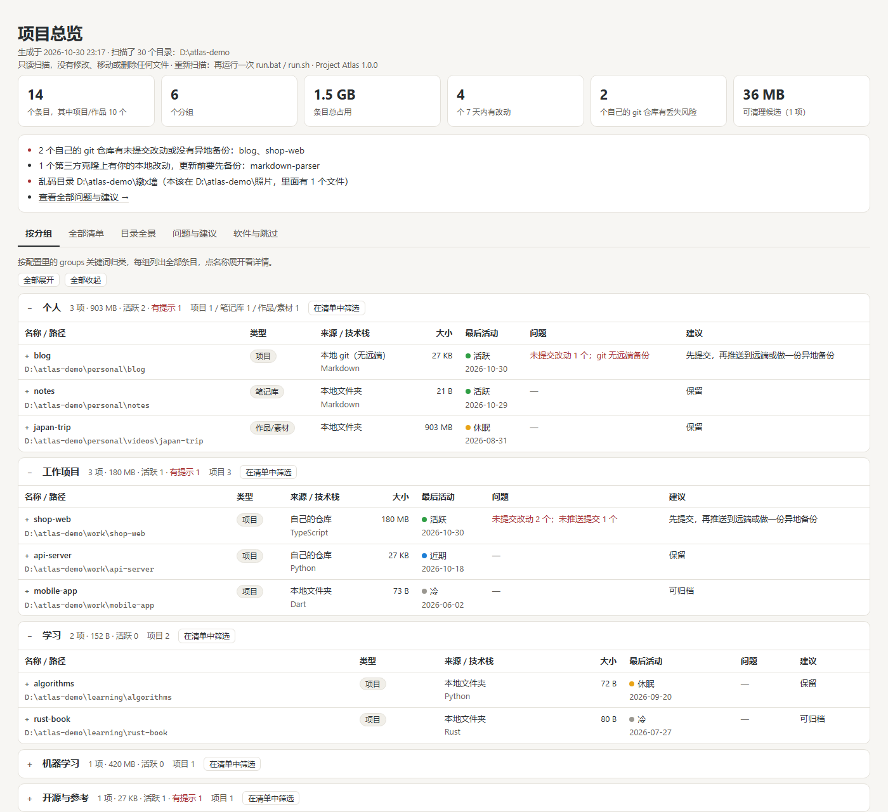
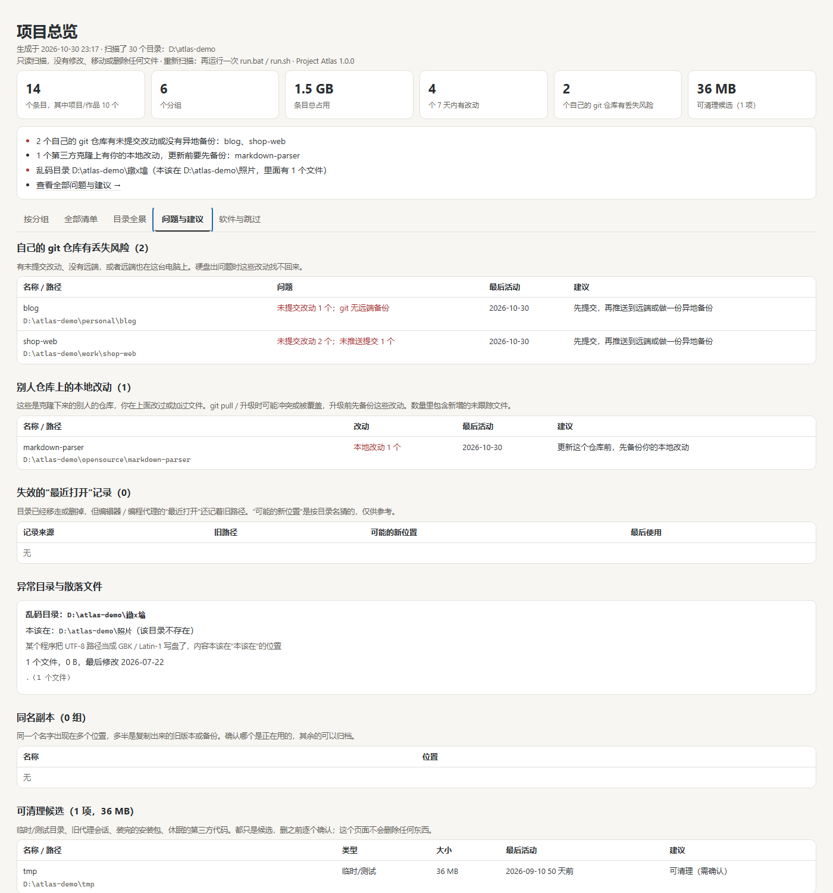

# Project Atlas

> A read-only scan of every project on your computer, rendered as one offline overview page: where each project lives, how big it is, when it was last touched, whether its git repo has uncommitted or unpushed work, and whether it has an off-machine backup.

Built for the case where projects are scattered across several drives and folders and you can no longer tell how many there are, which are still alive, or which have no backup.



The interface is in Chinese; this page mirrors the Chinese [README.md](README.md) section for section.

## At a glance

| Item | Value |
|---|---|
| Version | 1.0.0 (single source: `project_atlas/__init__.py`, git tag `v1.0.0`) |
| Runtime | Python ≥ 3.9, standard library only, nothing to install |
| Platforms | Windows / macOS / Linux; the UI is a local HTML file opened in your browser |
| Footprint | 96.0 KiB of code, 307.2 KiB of screenshots, no downloaded dependencies |
| Output | `project-atlas.html` (one offline page), `projects.csv`, optional `atlas.json` |
| Not included | no daemon, no background monitoring, no upload, no accounts |
| License | MIT |

## What it does today

| Capability | Status | Notes |
|---|---|---|
| Scan every local disk + your home directory | ✅ | Windows scans fixed local volumes (external USB drives included); macOS / Linux scan the home directory |
| Detect projects | ✅ | 31 marker files + 6 marker extensions (37 in total); `node_modules` and virtualenvs are never reported as projects |
| Fold backup / temp / research / skill folders | ✅ | Only explicit wording counts, so projects like `code-review-bot` stay projects |
| Git state | ✅ | uncommitted changes, unpushed commits, no remote, remote on this machine, foreign ownership, empty `.git` |
| Editor / agent "recently opened" | ✅ | VS Code family (Code, Cursor, Trae, …), JetBrains, Claude Code, Codex |
| Anomalies | ✅ | garbled folder names, leftover percent-escaped names, Git-Bash path artifacts at drive roots, stray files, npm leftovers in the home directory |
| One offline page + CSV + JSON | ✅ | opens from `file://`, no external assets, not a single network request |
| Windows | ✅ | run locally + CI (Python 3.9 / 3.13) |
| Linux | ✅ | CI (Ubuntu, Python 3.13) |
| macOS | ⏳ | CI job configured, but the runner kept queueing or got cancelled — no successful run yet |
| English UI | ⏳ | UI is Chinese only; this file is the English documentation |
| Incremental scan / cache | ⏳ | none, every run is a full scan |

## Quick start

**Requirement:** Python 3.9 or newer ([download](https://www.python.org/downloads/)). No Node, no admin rights, no network access.

1. Get the code: **Code → Download ZIP**, or `git clone`.
2. Launch:
   - **Windows**: double-click `run.bat`
   - **macOS / Linux**: `./run.sh`
   - Any OS: `python -m project_atlas`
3. When the scan finishes your browser opens the overview; start with the "问题与建议" (issues) tab.

Defaults: all local disks plus your home directory. On Windows the system drive is scanned 3 levels deep, other drives 7, the home directory 6; system and cache folders are skipped.

Useful switches: `--exclude DIR` (skip folders, repeatable), `--depth N`, `--no-recents` (don't read editor history), `--no-git` (run no git commands at all), `-o DIR` (output folder). See `python -m project_atlas --help`.

## What is on the page

| View | Content |
|---|---|
| By location / by group | grouped by containing folder by default; define `groups` to group by product line. Each group lists all its entries; click a name for details |
| All entries | search (including a `path:` prefix), filter by type / status / root, sort by size or last activity |
| Directory panorama | every first-level subfolder of each root and group folder, labelled project / group / software / skipped / other |
| Issues | repos at risk of losing work, local edits to other people's repos, stale "recently opened" records, anomalies, duplicate copies, cleanup candidates, regenerable dependencies |
| Software & skipped | folders recognised as software / runtimes, and every skipped folder with the reason |



`projects.csv` is written next to the page and opens directly in Excel.

## Self-check

Run this from the repository root; it prints the elapsed time, the output folder and the entry count.

```bash
python -c "import contextlib,io,json,os,subprocess,tempfile,time;subprocess.run(['python','scripts/make_demo.py','demo-tree'],check=True,capture_output=True);d=tempfile.mkdtemp();from project_atlas.__main__ import main;t=time.time();ctx=contextlib.redirect_stdout(io.StringIO());ctx.__enter__();main(['demo-tree','-c','demo-tree/atlas.config.json','-o',d,'--json','--no-recents']);ctx.__exit__(None,None,None);rows=json.load(open(os.path.join(d,'atlas.json'),encoding='utf-8'))['rows'];print('%d 个条目，%.2f GB，用时 %.2f 秒'%(len(rows),sum(r['size'] or 0 for r in rows)/2**30,time.time()-t))"
```

Measured on the development machine (Windows 11, Python 3.11.9): the command above scans the fictional demo tree, 14 entries / 1.50 GB, about 1.4 s on a cold run and under 1 s warm; scanning this repository itself takes 0.02 s; a full first scan of three local drives plus the home directory, 326.5 GB, took 72 s.

## Configuration

Optional file `atlas.config.json` in the directory you run from (or pass `-c`). Every field may be omitted.

```json
{
  "roots": ["D:\\", "~/code"],
  "exclude": ["D:\\Games"],
  "github_users": ["your-github-name"],
  "groups": [
    {"name": "Blogs", "keywords": ["blog", "site"]},
    {"name": "Machine learning", "keywords": ["model", "train"]}
  ]
}
```

| Field | Default | Meaning |
|---|---|---|
| `roots` | all local disks + home | folders to scan; `["D:\\", 4]` sets the depth for one root |
| `exclude` | empty | folders to skip |
| `github_users` | empty | your GitHub / GitLab / Gitee user or org names; without them the tool cannot tell your repos from other people's |
| `groups` | empty | group entries by path keyword; unmatched entries go to "other". Without it, entries are grouped by location |
| `max_depth` | 7 | levels below a normal root |
| `system_drive_depth` | 3 | levels below the Windows system drive |
| `home_depth` | 6 | levels below the home directory |
| `recents` | `true` | read editor "recently opened" history |
| `anomalies` | `true` | run the anomaly checks |
| `git` | `true` | run read-only git commands |
| `workers` | 6 | threads used while measuring sizes |
| `discover_limit_s` | 300 | time budget for finding projects; unfinished folders are listed |
| `analyze_limit_s` | 900 | time budget for measuring; unfinished entries are marked |

`atlas.config.json` can contain your folder layout and account names — do not commit it to a public repository. This project's `.gitignore` already excludes it and `output/`.

## Output format

`atlas.json` (with `--json`) is the raw data behind the page. Top-level keys: `generated`, `version`, `sep`, `roots`, `group_mode`, `scan`, `rows`, `dups`, `containers`, `panorama`, `stale`, `anomalies`, `apps`, `skipped`.

One record from `rows[]` (abridged):

```json
{
  "name": "shop-web",
  "path": "D:\\atlas-demo\\work\\shop-web",
  "group": "工作项目",
  "type": "项目",
  "origin_code": "own",
  "risk": "own",
  "langs": ["TypeScript"],
  "size": 188771534,
  "files": 35,
  "buckets": {"依赖": 188743680, "git": 27625},
  "last": 1793375260.3,
  "status": "活跃",
  "issues": ["未提交改动 2 个", "未推送提交 1 个"],
  "git": {"branch": "master", "commits": "1", "remote": "https://github.com/your-name/shop-web.git",
          "dirty": 2, "unpushed": 1}
}
```

- `path` is absolute; the separator is in `sep`. `size` is bytes and includes dependencies and build output; above 400,000 files `capped` is `true` and `size` is a lower bound. `last` is a Unix timestamp in seconds.
- `type` is one of 项目 (project), 作品/素材 (artwork/assets), 笔记库 (notes vault), 备份/归档 (backup), 临时/测试 (temp/test), 研究/审查 (research/review), 技能/资料合集 (skills/reference), 自动生成的会话目录 (generated session folder).
- `origin_code`: `own`, `other`, `remote` (has a remote but `github_users` is unset; the owner name is included), `local`, `localremote`, `broken`, `untrusted`, `unavailable`, `src`, `folder`.
- `risk`: `own` (your changes with no off-machine backup), `mod` (local edits on someone else's repo), `unknown`, or `null`.
- Fields are guaranteed only for the current version; check `version` in scripts.

## How projects are detected

- **Project**: the folder contains one of 31 marker files or 6 marker extensions (37 in total) — `.git`, `package.json`, `pyproject.toml`, `Cargo.toml`, `go.mod`, `pom.xml`, `CMakeLists.txt`, `*.sln`, `*.xcodeproj`, `project.godot`, `ProjectSettings`, `Dockerfile`, `.obsidian`, `draft_content.json`, … Scanning stops there.
- **Loose project**: no marker file, but a few code files or AI/IDE config (`.cursor`, `.claude`, `.vscode`, `AGENTS.md`, …).
- **Collection**: a path segment containing backup, archive, snapshot, historical, tmp, temp, scratch, test, verify, research, review, audit, scan, awesome, skill, 备份, 临时, 测试, 调研, 审查 or 合集 folds everything below the outermost match into one entry. A project's own name only counts when it is explicitly a copy/temp name.
- **Group**: numbered folders such as `01_work`, or folders named projects, code, workspace, desktop, documents, downloads.
- **Last activity**: the newest of file mtimes, last commit and last editor open; logs, databases and lock files written by running programs are ignored.
- **Never entered**: `node_modules`, virtualenvs, `__pycache__`, `dist`/`build`, editor extensions, caches, recycle bins, system folders, cloud-sync folders, symlinks.

All of this lives in [`project_atlas/rules.py`](project_atlas/rules.py).

## How it runs

```
run.bat / run.sh ─┐
python -m project_atlas ─┴→ [1] config (defaults → atlas.config.json → CLI flags)
                              ↓
                        [2] discover: walk the roots, stop at each project root
                              + read editor / agent "recently opened" history
                              ↓
                        [3] organise: fold collections, find groups, merge recents, list stale records, build panorama
                              ↓
                        [4] measure: size / last change / stack / git state in parallel threads + anomaly checks
                              ↓
                        [5] render: project-atlas.html + projects.csv (+ atlas.json)
```

Three rules that make the result trustworthy:

1. **Read-only**: no writes into user folders. The only writes are into the `-o` output folder and a temporary copy of an editor's `state.vscdb`, deleted immediately after reading.
2. **Stay inside**: symlinks and junctions are never followed, cloud placeholder files are never read, excluded folders are never touched.
3. **Self-contained**: the page loads no external assets and makes no network requests; it works straight from `file://`.

## Repository layout

```text
project_atlas/
  __main__.py          69 lines   CLI: arguments → four stages → report
  rules.py            125 lines   classification rules (markers, collections, groups, skips)
  scan.py             338 lines   read-only scan: discovery, sizes, git state (largest file)
  organize.py         193 lines   fold candidates into entries, collections, groups, panorama
  context.py          254 lines   editor/agent recents and anomaly checks
  build.py            223 lines   rows, CSV, HTML
  config.py            99 lines   config merge and root auto-detection
  web/template.html   155 lines   page shell and styles
  web/app_core.js     210 lines   table, filters, sorting, details, events
  web/app_views.js    200 lines   overview, alerts, groups, panorama, issues, software views
scripts/make_demo.py  111 lines   builds the fictional demo tree behind the screenshots
scripts/check_readme.py  153 lines   keeps the numbers in these READMEs honest
tests/test_atlas.py   171 lines   13 tests
```

`scan.py` is the largest file at 338 lines; growing beyond that, it should split into discovery and measurement.

## Tests

```bash
python -m unittest discover -s tests -v
```

Actual output on the development machine (Windows 11, Python 3.11.9):

```text
Ran 13 tests in 0.667s
OK (skipped=1)
```

The skipped one is `test_symlinks_are_not_followed`: creating symlinks needs extra privileges on Windows; the Linux/macOS CI jobs run it for real.

CI ([.github/workflows/tests.yml](.github/workflows/tests.yml)) runs Windows 3.9 / 3.13, Ubuntu 3.13 and macOS 3.13, plus `pip install .` followed by `project-atlas --version`.

## Packaging and releases

No build step — the source runs as-is. `pip install .` adds the `project-atlas` command (same as `python -m project_atlas`).

| Artifact | Where | Expires? |
|---|---|---|
| Release source archive | [Releases → v1.0.0](../../releases/latest), Source code (zip) | never |
| Latest code | this repo, Code → Download ZIP | moves with `main` |
| Size | 96.0 KiB of code, 307.2 KiB of screenshots | — |

The scripts are not code-signed, so Windows may show SmartScreen ("Windows protected your PC"); choose "More info → Run anyway".

## Security and privacy

| Surface | Behaviour |
|---|---|
| Network | none — no telemetry, no update check, no upload |
| Disk writes | only the `-o` output folder. Exception: an editor's `state.vscdb` is copied to the system temp folder before reading and deleted right after |
| Cloud drives | iCloud Drive, Dropbox, Google Drive, Baidu Netdisk, Nutstore, WPS Cloud, Thunder, Quark, Aliyun and every OneDrive folder are skipped; files carrying the cloud-placeholder attribute are never read, so nothing is downloaded |
| Links | symlinks and junctions are never followed |
| git | only `rev-parse`, `log`, `status`, `rev-list`, `remote get-url` — no fetch, no push, no config changes. `status` does run filters a repository configures for itself (Git LFS, for example); use `--no-git` on untrusted downloads |
| git safety | repositories owned by another user are reported as "foreign owner, not read" instead of being forced open with `safe.directory` |
| Credentials | `user:token@` inside remote URLs is stripped |
| Output | the page and CSV **contain your local paths and project names** — think before sharing. `output/` is git-ignored |

## Known limitations

1. **Chinese interface only**; this page is the English documentation.
2. **macOS is untested**: a macOS CI job exists but kept queueing or got cancelled, so there is no successful run yet. Linux has only run in CI on Ubuntu, not on a real desktop.
3. **JetBrains and Codex history is unverified**: implemented against their documented default locations, but the development machine had no such records to compare with. The VS Code family, Cursor, Trae and Claude Code were verified on Windows.
4. **Classification is heuristic**: folders named with old / backup / tmp / test / review / skill may be folded into a collection; exotic project formats beyond Xcode, Unity and Godot are not recognised.
5. **The symlink test is skipped on Windows** and only really runs in the Linux/macOS CI jobs.
6. **At most 400,000 files per entry** (beyond that the size is a lower bound); discovery is capped at 300 s and measurement at 900 s, and unfinished entries are marked.
7. **No incremental scanning or cache** — every run scans everything, which is slow on large disks the first time.
8. **Default scope**: Windows scans only volumes of type "fixed" (external hard disks count; USB sticks, network drives and optical drives do not). Linux/macOS scan the home directory only — add other mounts to `roots`.
9. **"Last activity" is an estimate** from file mtimes, commits and editor opens; folders where a program keeps writing logs look busier than they are.
10. **No deduplication**: duplicate copies are listed, but deciding which one to keep is up to you.

## FAQ

**Too slow?** Exclude the folders holding games, media or models with `--exclude`, or lower the depth with `--depth`. Folders that hit the time limit are listed under "software & skipped" instead of hanging the scan.

**macOS asks for Documents/Downloads permission?** Allow it to scan those folders; denied folders are skipped and reported as "no permission".

**A project was not recognised?** Add its marker file to `TERMINAL` in `rules.py`, or put its folder in `roots`, then run again.

**"git does not trust this folder (foreign owner)"?** That is git's own protection for folders owned by another user (external drives, copies from another machine). Change ownership or accept the note.

**The browser did not open?** The page is `output/project-atlas.html` under the directory you ran from; open it directly.

## Related documents

- [README.md](README.md) — the Chinese original
- [atlas.config.example.json](atlas.config.example.json) — every field with its default
- [project_atlas/rules.py](project_atlas/rules.py) — the classification rules
- [scripts/make_demo.py](scripts/make_demo.py) — builds the fictional tree used for the screenshots
- [scripts/check_readme.py](scripts/check_readme.py) — checks numbers, line counts and defaults in both READMEs
- [.github/workflows/tests.yml](.github/workflows/tests.yml) — CI configuration

## License

MIT, see [LICENSE](LICENSE). No third-party code was borrowed; everything is built on the Python standard library, and the page is hand-written HTML/CSS/plain JavaScript with no frontend framework and no CDN.
