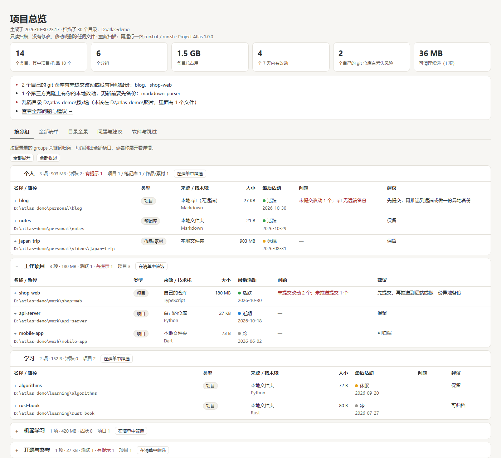
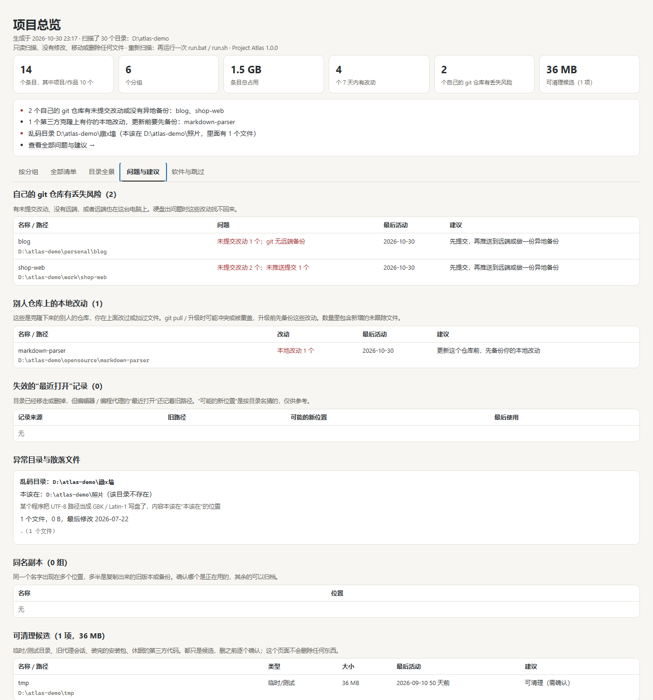

# 项目总览 · Project Atlas

> 只读扫描电脑上的所有项目，生成一个离线可打开的总览页面：每个项目在哪、多大、最后什么时候动过、git 有没有没提交的改动、有没有异地备份。

适合项目散落在好几个盘、好几个文件夹里，已经记不清“到底有多少个项目、哪些还在用、哪些没备份”的情况。



## 速览

| 项 | 值 |
|---|---|
| 版本 | 1.0.0（唯一来源 `project_atlas/__init__.py`，git tag `v1.0.0`） |
| 运行环境 | Python ≥ 3.9，只用标准库，不用装第三方包 |
| 平台 | Windows / macOS / Linux；图形界面是本地 HTML，浏览器打开 |
| 体积 | 程序本体 96.0 KiB，文档截图 307.2 KiB；不下载任何依赖 |
| 产物 | `project-atlas.html`（单文件离线页）、`projects.csv`、可选 `atlas.json` |
| 不包含 | 常驻服务、后台监控、上传、账号体系 |
| 许可 | MIT |

## 现在能做什么

| 能力 | 状态 | 说明 |
|---|---|---|
| 扫描所有本地磁盘 + 用户主目录 | ✅ | Windows 默认扫固定磁盘（含移动硬盘），macOS / Linux 默认扫用户主目录 |
| 识别项目 | ✅ | 31 种标志文件 + 6 种标志扩展名（共 37 种）；`node_modules`、虚拟环境不会被当成项目 |
| 备份 / 临时 / 研究 / 技能目录折叠成合集 | ✅ | 只认目录名里的明确写法，`code-review-bot` 这类项目不受影响 |
| git 状态 | ✅ | 未提交改动、未推送提交、无远端、远端在本机、属主不同、空的 `.git` |
| 编辑器 / 代理的“最近打开” | ✅ | VS Code 系（Code、Cursor、Trae 等）、JetBrains、Claude Code、Codex |
| 异常检查 | ✅ | 乱码目录、转义残留目录、Windows 盘根的路径误转换目录、散落文件、主目录 npm 残留 |
| 单文件离线页面 + CSV + JSON | ✅ | 页面 `file://` 直接打开，无外部资源，不发一个网络请求 |
| Windows | ✅ | 本机实跑 + CI（Python 3.9 / 3.13） |
| Linux | ✅ | CI（Ubuntu，Python 3.13） |
| macOS | ⏳ | 只在 CI 里配了 macOS 任务，运行器排队或被取消，还没跑出过一次结果 |
| 英文界面 | ⏳ | 界面只有中文；本页有[英文版](README.en.md) |
| 增量扫描 / 缓存 | ⏳ | 没有，每次都是全量扫描 |

## 快速开始

**前置条件：** Python 3.9 或更高版本（[下载](https://www.python.org/downloads/)）。不需要 Node、不需要管理员权限、不需要联网。

1. 拿到代码：在本仓库点 **Code → Download ZIP** 解压，或者 `git clone`。
2. 启动：
   - **Windows**：双击 `run.bat`
   - **macOS / Linux**：在终端里 `./run.sh`
   - 命令行：`python -m project_atlas`
3. 扫完会用浏览器打开总览页，从“问题与建议”看起最快。

默认扫描所有本地磁盘和用户主目录。Windows 系统盘只看 3 层、非系统盘 7 层、用户主目录 6 层，系统目录和缓存目录直接跳过。

**排障用的开关：**

| 情况 | 加这个 |
|---|---|
| 太慢 | `--exclude D:\Games --depth 4` |
| 不想读编辑器的最近打开记录 | `--no-recents` |
| 不想执行任何 git 命令 | `--no-git` |
| 想换输出位置 | `-o D:\atlas-out` |

完整参数：`python -m project_atlas --help`。

## 页面里有什么

| 视图 | 内容 |
|---|---|
| 按位置 / 按分组 | 默认按所在文件夹分组；配置了 `groups` 后按你定义的产品线分。每组列出全部条目，点名称看详情 |
| 全部清单 | 搜索（支持 `path:` 前缀按路径匹配）、按类型 / 状态 / 根目录筛选、按大小或最后活动排序 |
| 目录全景 | 每个根目录和分组目录下的每一个子目录都标明是什么：项目、分组、软件、跳过或其他 |
| 问题与建议 | 必看。有丢失风险的仓库、别人仓库上的改动、失效的“最近打开”记录、异常目录、同名副本、可清理候选、可重新生成的依赖 |
| 软件与跳过 | 被识别为软件 / 运行环境的目录，以及跳过的目录和原因 |



同时会生成 `projects.csv`，可以直接用 Excel 打开。

## 自测一下

在仓库根目录运行下面这一行，能看到条目数、总大小和扫描用时。数字会因机器和磁盘而异；`demo-tree/` 是生成的虚构示例目录，跑完可以直接删掉（已在 `.gitignore` 里）。

```bash
python -c "import contextlib,io,json,os,subprocess,tempfile,time;subprocess.run(['python','scripts/make_demo.py','demo-tree'],check=True,capture_output=True);d=tempfile.mkdtemp();from project_atlas.__main__ import main;t=time.time();ctx=contextlib.redirect_stdout(io.StringIO());ctx.__enter__();main(['demo-tree','-c','demo-tree/atlas.config.json','-o',d,'--json','--no-recents']);ctx.__exit__(None,None,None);rows=json.load(open(os.path.join(d,'atlas.json'),encoding='utf-8'))['rows'];print('%d 个条目，%.2f GB，用时 %.2f 秒'%(len(rows),sum(r['size'] or 0 for r in rows)/2**30,time.time()-t))"
```

本机实测（Windows 11，Python 3.11.9）：上面这条命令扫虚构的示例目录，14 个条目、1.50 GB，第一次约 1.4 秒（缓存热了 1 秒内）；扫仓库自己 3 个条目，0.02 秒；整机第一次完整扫描 3 个本地盘加用户主目录共 326.5 GB，用时 72 秒。

## 配置

配置文件是可选的，叫 `atlas.config.json`，放在你运行命令的目录下（或用 `-c` 指定）。所有字段都可以不写。

```json
{
  "roots": ["D:\\", "~/code"],
  "exclude": ["D:\\Games"],
  "github_users": ["your-github-name"],
  "groups": [
    {"name": "个人网站", "keywords": ["blog", "site"]},
    {"name": "机器学习", "keywords": ["model", "train"]}
  ]
}
```

| 字段 | 默认 | 说明 |
|---|---|---|
| `roots` | 所有本地磁盘 + 用户主目录 | 要扫描的目录；可写成 `["D:\\", 4]` 单独指定层数 |
| `exclude` | 空 | 不扫描的目录 |
| `github_users` | 空 | 你的 GitHub / GitLab / Gitee 用户名或组织名；填了才能分清“自己仓库没推送的改动”和“别人仓库上的本地改动” |
| `groups` | 空 | 按路径关键词归到产品线；没命中的归“其他”。不配置就按所在位置分组 |
| `max_depth` | 7 | 普通根目录往下扫几层 |
| `system_drive_depth` | 3 | Windows 系统盘往下扫几层 |
| `home_depth` | 6 | 用户主目录往下扫几层 |
| `recents` | `true` | 是否读取编辑器的“最近打开”记录 |
| `anomalies` | `true` | 是否做异常检查 |
| `git` | `true` | 是否运行只读 git 命令 |
| `workers` | 6 | 统计大小时并行几个线程 |
| `discover_limit_s` | 300 | 找项目最多花多少秒，超时的目录会列出来 |
| `analyze_limit_s` | 900 | 统计大小最多花多少秒，超时的条目标“未统计完” |

注意：`atlas.config.json` 里有你的目录结构和账号名，**别提交到公开仓库**。本项目的 `.gitignore` 已经把它和 `output/` 排除在外。

## 输出格式

`atlas.json`（加 `--json`）是页面用的原始数据，可以用脚本读。顶层字段：`generated`、`version`、`sep`、`roots`、`group_mode`、`scan`、`rows`、`dups`、`containers`、`panorama`、`stale`、`anomalies`、`apps`、`skipped`。

一条记录的样子（`rows[]`，字段有删减）：

```json
{
  "name": "shop-web",
  "path": "D:\\atlas-demo\\work\\shop-web",
  "group": "工作项目",
  "type": "项目",
  "origin": "自己的仓库",
  "origin_code": "own",
  "risk": "own",
  "langs": ["TypeScript"],
  "size": 188771534,
  "files": 35,
  "buckets": {"依赖": 188743680, "git": 27625},
  "last": 1793375260.3,
  "status": "活跃",
  "issues": ["未提交改动 2 个", "未推送提交 1 个"],
  "advice": "先提交，再推送到远端或做一份异地备份",
  "desc": "小店前台：商品页、购物车和下单",
  "git": {"branch": "master", "commits": "1", "remote": "https://github.com/your-name/shop-web.git",
          "dirty": 2, "unpushed": 1, "last_commit": 1793116059, "subject": "first version"}
}
```

约定：

- `path` 是绝对路径，分隔符按平台（Windows 反斜杠，macOS / Linux 斜杠），`sep` 字段给出。
- `size` 是字节，含依赖和构建产物；超过 40 万个文件时 `capped` 为 `true`，`size` 只是下限。
- `last` 是 Unix 时间戳（秒）。
- `type`：`项目`、`作品/素材`、`笔记库`、`备份/归档`、`临时/测试`、`研究/审查`、`技能/资料合集`、`自动生成的会话目录`。
- `origin_code`：`own`（自己的仓库）、`other`（别人的仓库）、`remote`（有远端但没配置 `github_users`，附 owner 名）、`local`（本地 git 无远端）、`localremote`（远端在本机）、`broken`（空 `.git`）、`untrusted`（属主不同）、`unavailable`（没装 git）、`src`（下载的源码）、`folder`（普通文件夹）。
- `risk`：`own`（自己的改动没有异地备份）、`mod`（别人仓库上的本地改动）、`unknown`（分不清归属但有未保存改动）、`null`。
- 字段只保证在当前版本可用，之后可能新增；脚本里建议先判断 `version`。

## 怎么判断的

- **项目**：目录里有 `.git`、`package.json`、`pyproject.toml`、`Cargo.toml`、`go.mod`、`pom.xml`、`CMakeLists.txt`、`*.sln`、`*.xcodeproj`、`project.godot`、`ProjectSettings`、`Dockerfile`、`.obsidian`、`draft_content.json` 等 31 种标志文件 / 6 种标志扩展名之一（共 37 种），扫描到这里就停，不再往下。
- **散装项目**：没有标志文件，但有几个代码文件或 AI / IDE 配置（`.cursor`、`.claude`、`.vscode`、`AGENTS.md` 等）。
- **合集**：路径上出现 backup、archive、snapshot、historical、tmp、temp、scratch、test、verify、research、review、audit、scan、awesome、skill、备份、临时、测试、调研、审查、合集 等写法，从最外层那一级折叠成一条；项目自己的名字只认明确的副本 / 临时写法。
- **分组**：名字是 `01_工作` 这类编号目录，或者 projects、code、workspace、桌面、文档、下载、我的项目 等放项目的地方。
- **最后活动**：文件修改时间、最后一次提交、编辑器最后打开时间中最新的一个；日志、数据库、锁文件这类程序自己会写的文件不算。
- **不进入**：`node_modules`、虚拟环境、`__pycache__`、`dist` / `build`、编辑器扩展、各类缓存、回收站、系统目录、云同步盘、符号链接。

规则都在 [`project_atlas/rules.py`](project_atlas/rules.py) 一个文件里，可以按自己的习惯改。

## 它是怎么跑的

```
run.bat / run.sh ─┐
python -m project_atlas ─┴→ [1] 配置（默认值 → atlas.config.json → 命令行参数）
                              ↓
                        [2] 发现：遍历磁盘找项目根目录（遇到项目就停）
                              + 采集编辑器 / 代理的“最近打开”
                              ↓
                        [3] 组织：折叠合集、识别分组、补进最近打开、挑出失效记录、生成目录全景
                              ↓
                        [4] 统计：多线程量大小 / 最后改动 / 技术栈 / git 状态 + 异常检查
                              ↓
                        [5] 生成：project-atlas.html + projects.csv（可选 atlas.json）
```

三条硬规矩，破坏任何一条这个工具就不可信了：

1. **只读**：扫描阶段不写用户目录。唯一的写操作是输出到 `-o` 指定的目录，以及为了读编辑器数据库临时复制一份 `state.vscdb` 到系统临时目录、读完立刻删除。
2. **不越界**：不跟随符号链接 / junction，不读取云盘占位文件，不扫描 `--exclude` 里的目录。
3. **自包含**：结果页不引用任何外部资源、不发网络请求，`file://` 直接打开就能用。

## 目录

```text
project_atlas/
  __main__.py          69 行   命令行入口：参数 → 四步流程 → 打印结果
  rules.py            125 行   分类规则：项目标志、合集、分组、跳过名单
  scan.py             338 行   只读扫描：找项目、量大小、读 git 状态（最大的一个文件）
  organize.py         193 行   把候选目录归并成条目、合集、分组、目录全景
  context.py          254 行   编辑器/代理的最近打开、异常检查（乱码、散落文件等）
  build.py            223 行   生成行数据、CSV、HTML
  config.py            99 行   配置合并与根目录自动识别
  web/template.html   155 行   页面骨架与样式
  web/app_core.js     210 行   表格、筛选、排序、详情、事件
  web/app_views.js    200 行   概览、提醒、分组、全景、问题、软件视图
scripts/check_readme.py  153 行   核对 README 里的数字是否和代码一致
scripts/make_demo.py  111 行   造虚构的示例目录树（本页截图就是这样生成的）
tests/test_atlas.py   171 行   13 个测试
```

最大的单文件是 `scan.py`，338 行。它再长就应该拆成“发现”和“统计”两个模块。

## 测试

```bash
python -m unittest discover -s tests -v
```

本机（Windows 11，Python 3.11.9）实际输出：

```text
Ran 13 tests in 0.667s
OK (skipped=1)
```

跳过的是 `test_symlinks_are_not_followed`：Windows 上普通用户创建符号链接需要额外权限，CI 的 Linux / macOS 任务会真正跑它。

| 测试 | 覆盖什么 |
|---|---|
| `RulesTest`（3 项） | 合集识别：backup / tmp / research / awesome / 时间戳目录；不误伤 `qr-scanner`、`latest`、`template`、`contest`；项目自己的名字只认明确的副本写法 |
| `DescribeTest`（1 项） | `package.json` 里 `\uXXXX` 转义的中文说明能正确还原 |
| `PipelineTest`（9 项） | 造一棵目录树跑完整流程：分类正确、依赖不算项目、git 状态、三个产物都生成、没有扫到根目录之外、只读（原文件还在）、不跟随符号链接、乱码目录能认出来 |

CI（[.github/workflows/tests.yml](.github/workflows/tests.yml)）：Windows 3.9 / 3.13、Ubuntu 3.13、macOS 3.13，外加 `pip install .` 之后用 `project-atlas --version` 验证安装。

## 打包与发布

不需要构建，源码直接能跑。想要命令形式就 `pip install .`，会得到 `project-atlas` 命令（等价于 `python -m project_atlas`）。

| 产物 | 地址 | 会不会过期 |
|---|---|---|
| 发布版源码包 | [Releases → v1.0.0](../../releases/latest) 里的 Source code (zip) | 永久 |
| 最新代码 | 本仓库 Code → Download ZIP | 随 main 变动 |
| 体积 | 程序 96.0 KiB，截图 307.2 KiB | — |

Windows 第一次运行可能出现 SmartScreen /“Windows 已保护你的电脑”提示，因为脚本没有代码签名：点“更多信息 → 仍要运行”。

## 安全与隐私

按“面”分行：

| 面 | 做法 |
|---|---|
| 网络 | 不联网。没有统计、没有更新检查、没有上传 |
| 写盘 | 只写 `-o` 指定的输出目录。例外：读 VS Code 系编辑器数据库时先复制一份 `state.vscdb` 到系统临时目录，读完立刻删除 |
| 云盘 | 跳过 iCloud Drive、Dropbox、Google Drive、百度网盘、坚果云、WPS 云文件、迅雷云盘、夸克网盘、阿里云盘和所有 OneDrive 目录；不读取带云端占位属性的文件，避免触发下载 |
| 链接 | 不跟随符号链接、junction |
| git | 只跑 `rev-parse`、`log`、`status`、`rev-list`、`remote get-url`，不 fetch、不 push、不改配置。`status` 会执行仓库自己配置的过滤器（例如 Git LFS），扫来路不明的下载目录时建议 `--no-git` |
| git 保护 | 属主不同的仓库会被 git 拒绝，工具如实标“属主不同，未读取”，不会用 `safe.directory` 绕过 |
| 凭据 | 远端地址里的 `user:token@` 会被去掉 |
| 输出 | 页面和 CSV 里**有你的本机路径和项目名**，分享前先想清楚。`output/` 已在 `.gitignore` 里 |

## 已知边界

1. **界面只有中文**，英文用户只能看 [README.en.md](README.en.md)。
2. **macOS 完全没验过**：CI 里配了 macOS 任务，但运行器排队或被取消，至今没有一次成功记录。Linux 只在 CI 的 Ubuntu 上跑过，没在真实桌面上用过。
3. **JetBrains 和 Codex 的“最近打开”没验证过**：按官方默认位置实现（`recentProjects.xml`、`sessions/**.jsonl`），开发机上没有这两类记录可以对照。VS Code 系、Cursor、Trae、Claude Code 在 Windows 上实测有效。
4. **分类是启发式**：名字里带 old / backup / tmp / test / review / skill 的目录可能被折叠成合集；`.xcodeproj`、Unity、Godot 工程之外的小众工程格式认不出来。
5. **符号链接的测试在 Windows 上会被跳过**，只在 CI 的 Linux / macOS 上真正执行。
6. **单个条目最多统计 40 万个文件**（超过则大小标为下限）；找项目限时 300 秒、统计限时 900 秒，超时的条目标“未统计完”。
7. **没有增量扫描和缓存**，每次都是全量扫；磁盘大的机器第一次会比较久。
8. **默认范围**：Windows 只扫“本地固定磁盘”类型的卷（移动硬盘算，U 盘、网络盘、光驱不算）；Linux / macOS 默认只扫用户主目录，其他挂载点要写进 `roots`。
9. **“最后活动”是推断**：取文件修改时间、最后提交、编辑器打开时间里最新的一个；程序自己写日志的目录会显得比实际更活跃。
10. **不做去重清理**：同名副本只是列出来，判断哪个该留是你的事。

## 常见问题

**扫得太慢？** 用 `--exclude` 排掉放游戏、影音、模型的大目录，或者用 `--depth` 少扫几层；超过时限的目录会在“软件与跳过”里列出来，不会卡死。

**macOS 弹出“访问文稿 / 下载文件夹”的权限提示？** 允许就能扫描这些目录；拒绝的目录按“无权限”跳过。

**某个项目没被认出来？** 在 `rules.py` 的 `TERMINAL` 里加上它的标志文件，或者把它所在目录写进 `roots`，然后重新跑一次。

**看到“git 不信任这个目录（属主不同）”？** 那是 git 自带的保护，说明目录属主不是当前用户（常见于外接硬盘、从别的电脑拷过来的目录）。可以改属主，或者接受这条提示。

**浏览器没自动打开？** 页面在运行目录下的 `output/project-atlas.html`，直接双击。

## 相关文档

- [README.en.md](README.en.md) — 英文版说明
- [atlas.config.example.json](atlas.config.example.json) — 完整配置示例，每个字段都用默认值写着
- [project_atlas/rules.py](project_atlas/rules.py) — 分类规则，想改判定就看这个
- [scripts/make_demo.py](scripts/make_demo.py) — 造虚构示例目录，本页截图用的就是它
- [scripts/check_readme.py](scripts/check_readme.py) — 核对 README 里的数字/行数/默认值，改了代码就顺手跑一下
- [.github/workflows/tests.yml](.github/workflows/tests.yml) — CI 配置

## 许可与致谢

MIT，见 [LICENSE](LICENSE)。没有借鉴第三方代码，全部基于 Python 标准库实现；页面是手写的 HTML / CSS / 原生 JavaScript，没有前端框架，也没有外部 CDN。
